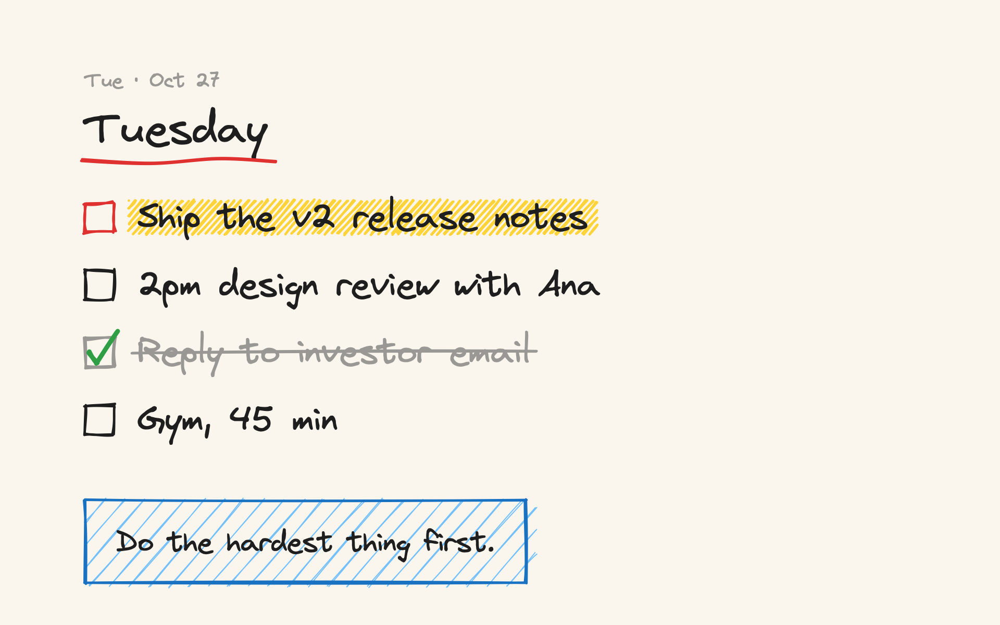

<p align="center">
  
</p>

# Mura — your AI agent writes tomorrow's plan onto your Mac wallpaper

<p align="center">
  <strong>English</strong> · <a href="README.zh-CN.md">中文</a> · <a href="LICENSE"></a>
</p>

**Mura is a 600 KB command-line tool for macOS. Your agent (Claude Code, Codex, …) tells it what you will do tomorrow; at midnight your desktop turns into that list, drawn in Excalidraw's hand-drawn style. You wake up, glance at the screen, and know your day.**



## Why

To-do apps wait for you to open them. The wallpaper is already in front of you. Mura v1 was a canvas you wrote on by hand; v2 is built for agents: no editor, no coordinates, no app running in the background. The agent sends text, Mura does the layout and the drawing.

## Install

Needs macOS 14+ and the Xcode command line tools (`xcode-select --install`).

```bash
git clone https://github.com/risingjerry/Mura && cd Mura && script/install.sh
```

This builds `mura` into `~/.local/bin`, downloads the two handwriting fonts (Virgil and Xiaolai, about 22 MB) and installs a LaunchAgent that switches the wallpaper after midnight. Nothing stays running.

## Use with Claude Code / Codex

```bash
npx skills add risingjerry/Mura      # or copy skills/mura into ~/.claude/skills/
```

Then talk normally: *"Tomorrow: finish the release notes first, design review at 2, gym in the evening — put it on my wallpaper."* When you finish something: *"Done with the design review."*

## Use it yourself

```bash
mura plan --date tomorrow "! Ship the release notes" "2pm design review" "Gym, 45 min"
mura add "Call the bank"          # today: the wallpaper updates right away
mura done 2                       # tick it off
mura render --date tomorrow       # preview PNGs, wallpaper untouched
mura undo                         # previous wallpaper back
mura help                         # every command, as JSON
```

A day is a Markdown file in `~/Library/Application Support/Mura/days/`: `# title`, `- [ ] item`, `- [x] done`, a leading `!` marks an item important, `> note` adds a sticky note.

## What it draws

- Your handwriting-style title with a red hand-drawn underline, the date above it.
- A sketchy checkbox per item; important items get a yellow highlighter, finished ones a green tick and a strike-through, and "All done!" is circled once everything is ticked.
- Font size, wrapping and a second column are chosen to fit each display; overflow becomes "…and N more".
- One render per display at native resolution, on every desktop Space.

## How it works

Swift + CoreText + CoreGraphics. The sketchy shapes come from [rough.js](https://github.com/rough-stuff/rough) (the library behind Excalidraw) running in the system's JavaScriptCore, with no browser or web view. Rendering two 4K displays takes well under a second; `mura tick` takes milliseconds when nothing changed. macOS only changes the wallpaper of the current Space through its public API, so Mura also updates the other Spaces in the system wallpaper store. It backs the store up first, checks the result, and rolls back if macOS rejects it. Turn this off with `mura config set spaces current`.

## FAQ

**My Mac's clock is in a different timezone from the one I live by.** Run `mura config set timezone Asia/Shanghai` (any IANA name). "today" and the midnight switch follow it.

**Does anything upload my list?** No. Everything stays in `~/Library/Application Support/Mura`. The only network access is the one-time font download in `mura setup`.

**How do I get my old wallpaper back?** `mura undo` (repeat to go further back), or pick one in System Settings → Wallpaper.

**Where is the v1 drawing canvas?** v1 (menu bar app with a hand-drawing editor) stays on the `main` branch and in Releases. v2 drops the editor on purpose.

## Uninstall

```bash
mura schedule uninstall && mura undo   # stop the switch, restore your wallpaper
rm ~/.local/bin/mura && rm -rf ~/Library/Application\ Support/Mura
```

## License

MIT. rough.js is MIT; Virgil and Xiaolai are SIL OFL 1.1 and are downloaded, not bundled. See [THIRD_PARTY_NOTICES.md](THIRD_PARTY_NOTICES.md).

---

If Mura keeps your mornings clear, a star helps others find it.
