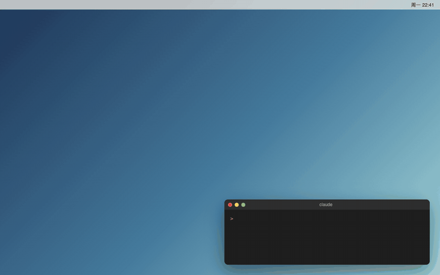
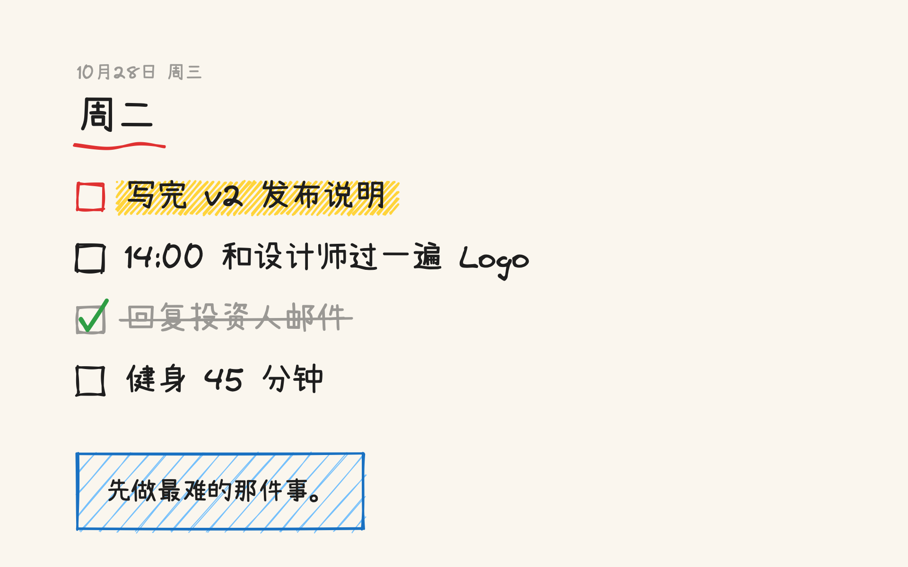

<p align="center">
  
</p>

# Mura — 让 AI Agent 把明天要做的事写到你的 Mac 桌面上

<p align="center">
  <a href="README.md">English</a> · <strong>中文</strong> · <a href="LICENSE"></a>
</p>

**Mura 是一个只有 600 KB 的 macOS 命令行小工具。你的 Agent（Claude Code、Codex……）把你明天要做的事交给它，过了零点，桌面就会变成这张清单，画风和 Excalidraw 一样是手绘的。早上醒来看一眼屏幕，就知道今天要干什么。**



## 为什么

待办软件要你自己去打开，桌面却一直摆在你眼前。Mura 专门做给 Agent 用：没有编辑器，不用算坐标，后台也不常驻任何程序。Agent 只管把文字交过来，排版和绘制都由 Mura 完成。

## 安装

一行命令，macOS 14 以上，Apple 芯片和 Intel 都支持：

```bash
curl -fsSL https://raw.githubusercontent.com/risingjerry/Mura/main/script/install.sh | sh
```

也可以从源码装（需要 Xcode 命令行工具）：`git clone https://github.com/risingjerry/Mura && cd Mura && script/install.sh`。

两种方式都会把 `mura` 装到 `~/.local/bin`，下载两款手写字体（Virgil 和小赖字体，约 22 MB），再装一个每天零点后自动切换壁纸的系统定时任务（LaunchAgent）。平时没有任何程序在后台跑。

## 在 Claude Code / Codex 里用

```bash
npx skills add risingjerry/Mura      # 或把 skills/mura 复制到 ~/.claude/skills/
```

然后正常说话就行：「明天先写完发布说明，下午两点评审设计，晚上健身，帮我放到桌面上。」做完一件事说一声：「设计评审搞定了。」

## 自己用

```bash
mura plan --date tomorrow "! 写完发布说明" "14:00 设计评审" "健身 45 分钟"
mura add "给银行打电话"            # 改今天的内容：壁纸马上更新
mura done 2                        # 勾掉第 2 件
mura render --date tomorrow        # 只生成预览图，不动壁纸
mura undo                          # 换回上一张壁纸
mura help                          # 列出所有命令（JSON 格式）
```

| 命令 | 作用 |
|---|---|
| `mura plan [--date D] 事项… \| --stdin \| --file F` | 整体替换某一天的清单（支持 Markdown） |
| `mura add 事项… [--important]` | 追加事项 |
| `mura done N…` / `undone N…` / `rm N…` | 按编号打勾、取消打勾、删除 |
| `mura title 文字` / `note 文字` / `clear` | 改标题、改便签、清空这一天 |
| `mura show` / `list` | 读取某一天 / 列出所有天（JSON） |
| `mura render [--size 宽x高]` | 只出预览图，不动壁纸 |
| `mura apply` / `undo` | 立刻换上壁纸 / 换回上一张 |
| `mura setup`、`schedule install\|uninstall\|status`、`config`、`doctor` | 安装、零点自动切换、设置、自检 |

日期可以写 `today`（默认）、`tomorrow`、`yesterday`、`+N`、`-N`、`YYYY-MM-DD`，也认「今天 / 明天 / 后天」。每条命令都只输出一个 JSON 对象，退出码 0 / 1 / 2 分别表示成功 / 失败 / 用法错误，Agent 可以放心解析。

每一天就是 `~/Library/Application Support/Mura/days/` 里的一个 Markdown 文件：`# 标题`、`- [ ] 事项`、`- [x] 已完成`，事项前加 `!` 表示重要，`> 一句话` 会变成底部的便签。

## 画出来是什么样



- 手写体标题，下面一条红色手绘下划线，标题上方是日期。
- 每件事前面一个手绘方框。重要的事涂上黄色荧光笔，做完的打绿勾并划掉；全部做完时，标题旁会圈出「全部搞定!」。
- 字号、换行、要不要分两栏都会按每块屏幕自动调整，实在放不下就显示「…还有 N 项」。
- 每块屏幕按原生分辨率单独出图，所有桌面（Space）一起换。

## 怎么做到的

用 Swift 加 macOS 自带的 CoreText 和 CoreGraphics 绘图。手绘线条来自 [rough.js](https://github.com/rough-stuff/rough)（Excalidraw 用的就是它），直接跑在系统自带的 JavaScriptCore 里，不需要浏览器，也不需要网页视图。两块 4K 屏一起出图用不到一秒；内容没变时，`mura tick` 只要几毫秒。

macOS 的公开接口只会换掉当前这个桌面的壁纸，所以 Mura 会另外去改系统的壁纸记录，让其他桌面也一起换。改之前先备份，改完检查一遍；万一 macOS 不认，就自动还原。不想要这个功能的话，运行 `mura config set spaces current` 关掉。

## 限制

- 只支持 macOS 14 以上。让所有桌面一起换，靠的是 macOS 没有公开说明的壁纸记录（已在 macOS 26 上实测）。如果以后的系统版本不认，Mura 会自动还原，只换当前这个桌面。
- 它是一张待办清单，不是任务管理软件：没有提醒、同步、重复任务。日程从哪来，交给你的 Agent 去读（日历、笔记、issue 都行）。
- 出图需要 `mura setup` 下载的手写字体。没装字体时会改用系统字体，并提示你。

## 常见问题

### 怎么把待办清单放到 Mac 桌面壁纸上？
装好 Mura 后运行 `mura plan "第一件事" "第二件事"`，或者直接让你的 Agent 去做。今天的清单会马上出现在桌面上。

### Claude Code 或 Codex 能自动帮我换 Mac 壁纸吗？
可以。先装上 skill（`npx skills add risingjerry/Mura`），再告诉 Agent 你打算做什么，它会自己调用 `mura`；以后哪天的清单，过了零点会自动换上。

### 我电脑的时区和我实际生活的时区不一样，「今天」按哪个算？
运行 `mura config set timezone Asia/Shanghai`（任意标准时区名都行）。「今天」怎么算、零点什么时候切换，都会按这个时区来。

### Mura 会上传我的清单吗？
不会。所有数据都在 `~/Library/Application Support/Mura` 里。唯一一次联网，是 `mura setup` 下载字体。

### 怎么换回原来的壁纸？
运行 `mura undo`（多次运行可以一步步往回退），或者去「系统设置 → 墙纸」里重新选。

### 它会一直在后台运行吗？
不会。系统定时任务每 5 分钟启动一次 `mura tick`，如果日期没变、内容也没变，几毫秒就退出。

## 卸载

```bash
mura schedule uninstall && mura undo   # 先停掉自动切换，再换回原来的壁纸
rm ~/.local/bin/mura && rm -rf ~/Library/Application\ Support/Mura
```

## 许可证

MIT。rough.js 用的是 MIT 许可证；Virgil 和小赖字体用的是 SIL OFL 1.1 许可证，都是安装时下载，不随仓库分发。详见 [THIRD_PARTY_NOTICES.md](THIRD_PARTY_NOTICES.md)。

---

如果 Mura 让你每天早上更清楚要做什么，点个 Star 能帮更多人找到它。

<a href="https://www.star-history.com/#risingjerry/Mura&Date">
  <picture>
    <source media="(prefers-color-scheme: dark)" srcset="https://api.star-history.com/svg?repos=risingjerry/Mura&type=Date&theme=dark" />
    
  </picture>
</a>
