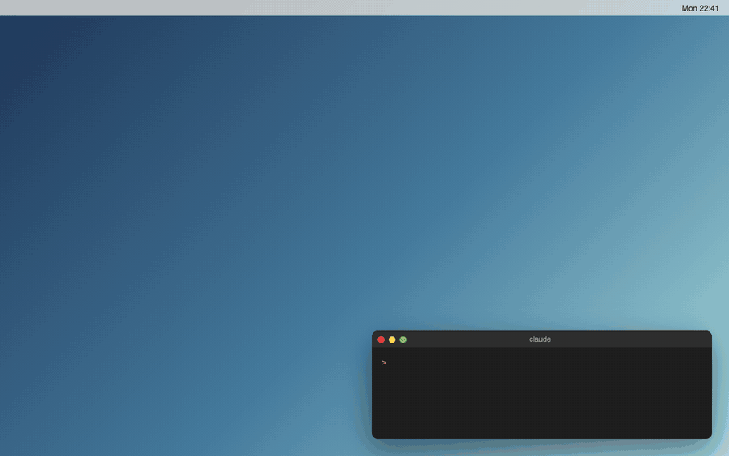

<p align="center">
  
</p>

# Mura — 把一块有限画布变成你的 Mac 桌面壁纸

**一款 macOS 菜单栏小工具：在画布上写字、涂鸦，一键保存成桌面壁纸。**

<p align="center">
  <a href="https://github.com/risingjerry/Mura/releases/latest"><strong>下载最新版</strong></a>
</p>

<p align="center">
  <a href="README.md">English</a> · <strong>中文</strong> · <a href="LICENSE"></a>
</p>



## Mura 是什么？

Mura 是一个很简单的 macOS 小工具：

> 你打开一块有限画布，在上面写字、涂鸦，然后把它保存成桌面壁纸。

它适合放那些你每天打开电脑就应该看见的东西：

- 今天最重要的几件事
- 一句提醒自己的话
- 一个随手画下来的箭头、圈、线条
- 不同屏幕上的不同提示

Mura 不想做复杂的任务管理软件。它只做一件事：**让你的桌面本身变成一块提醒画布。**

## 你可以做什么？

### 写下今天最重要的事情

用文字工具直接在画布上输入，保存后就是你的桌面壁纸。

### 随手涂鸦

用画笔画线、圈重点、加箭头，也可以用颜色区分不同提醒。


### 保存到桌面

点击「保存到桌面」后，Mura 会把当前画布渲染成一张静态壁纸。保存完不需要一直占用一个编辑器窗口。

## 安装

一键安装：打开「终端」，复制下面这一行命令回车即可。它会自动下载 Release 版本、安装到 `/Applications`、清除未签名版本的 quarantine 标记，并打开 Mura。

```bash
curl -fsSL https://raw.githubusercontent.com/risingjerry/Mura/main/script/install_release.sh | bash
```

如果你的 Mac 要求权限，终端会提示你输入登录密码。

也可以手动安装：

1. 打开 [Releases](https://github.com/risingjerry/Mura/releases/latest)。
2. 下载 `Mura-v1.dmg`。
3. 打开 DMG，把 `Mura.app` 拖进 `/Applications`。
4. 启动 Mura。

## 如果 macOS 提示无法打开

当前 v1 是未上架 App Store、未 Apple notarize 的版本，所以 macOS 可能会提示：

- “无法打开，因为无法验证开发者”
- “Apple 无法检查其是否包含恶意软件”
- “App 已损坏，无法打开”
- “Mura-v1.dmg is damaged and can’t be opened”

如果 **DMG 文件本身打不开**，先对下载的 DMG 执行：

```bash
sudo xattr -rd com.apple.quarantine ~/Downloads/Mura-v1.dmg
open ~/Downloads/Mura-v1.dmg
```

然后把 `Mura.app` 拖进 `/Applications`。如果拖进去之后 **Mura.app 仍然打不开**，再执行：

```bash
sudo xattr -rd com.apple.quarantine /Applications/Mura.app
open /Applications/Mura.app
```

注意：如果你还没有把 `Mura.app` 拖进 `/Applications`，`/Applications/Mura.app` 不存在，运行第二段命令就会出现 `No such file`。

只建议对从官方 Release 下载的 `Mura-v1.dmg` / `Mura.app` 执行这些命令。

## 亮点

- **有限画布**：像一块干净的白板，写字、涂鸦、换颜色。
- **保存到桌面**：渲染成一张普通 PNG 壁纸，保存后不占用编辑器窗口，也没有常驻的网页壁纸。
- **每个屏幕单独编辑**，多显示器可分别设置。
- **本地优先**：画布内容留在你的 Mac 上，不需要账号。
- **Agent 友好**：自带命令行工具 `dmwctl`，输出 JSON，Claude Code / Codex 可以直接把提醒写到壁纸上。

## 工作原理

Mura 是 SwiftPM 原生 macOS 菜单栏 App。编辑时打开一个内置的本地画布编辑器（WebView），保存时把画板 JSON 和 PNG 一起存到本地，再通过系统接口设为壁纸；之后编辑器被释放，系统显示的就是一张普通图片。命令行工具 `dmwctl` 读写的是同一份画板文件。

## 在 Claude Code / Codex 中使用

```bash
npx skills add risingjerry/Mura
```

也可以把 `skills/mura` 复制到 `~/.claude/skills/` 或 `~/.agents/skills/`。然后直接说：

- `把今天最重要的三件事写到我的桌面壁纸上`
- `在壁纸上给「周五交报告」画一条红色下划线`
- `恢复我之前的壁纸`

技能会让 Agent 先渲染预览，经你同意后才用 `--confirm` 真正改壁纸。`dmwctl` 不在 DMG 里，需要从仓库构建：`swift build -c release --product dmwctl`（macOS 14+ 和 Swift 工具链）。说明见 [AGENTS.md](AGENTS.md) 和 [skills/mura/SKILL.md](skills/mura/SKILL.md)。

## 限制与要求

- 仅限 macOS 14 或更高。
- v1 为 ad-hoc 签名，未经 Apple 公证（见上文「如果 macOS 提示无法打开」）。
- Mura 不是任务管理软件，只做一块提醒画布。
- 命令行工具需要自己用 Swift 构建。

## 常见问题

### 怎么把待办事项放到 Mac 桌面壁纸上？
安装 Mura，打开编辑画布，用文字工具写下事项，点「保存到桌面」。也可以让 Agent 通过 `dmwctl` 写入。

### 打开 Mura 提示「无法验证开发者」或「已损坏」怎么办？
见上文「如果 macOS 提示无法打开」。先试右键打开；仍不行再按说明执行 `xattr` 命令，且只对从官方 Release 下载的文件执行。

### 我的内容会上传吗？
不会。画布保存在 `~/Library/Application Support/DesktopMemoryWall`，不需要账号。

### 保存后还会一直占资源吗？
不会。保存或取消后编辑器 WebView 会被释放，桌面显示的只是一张普通 PNG 壁纸。

### 能不能让 AI Agent 帮我写壁纸？
可以，见「在 Claude Code / Codex 中使用」。Agent 默认只预览，必须经你确认才会更换壁纸。

### 怎么恢复原来的壁纸？
Mura 保存前会记录之前的壁纸。可以让 Agent 执行 `dmwctl wallpaper restore --confirm`，或者直接在「系统设置 → 墙纸」里换回。

## 卸载

1. 退出 Mura，把 `/Applications/Mura.app` 拖进废纸篓。
2. 先在「系统设置 → 墙纸」里换回你想要的壁纸（或用 `dmwctl wallpaper restore --confirm`）。
3. 可选：删除本地数据 `rm -rf ~/Library/Application\ Support/DesktopMemoryWall`。

## 隐私

Mura 是本地优先的桌面工具。画布内容保存在你的 Mac 本地，不需要账号，也不会上传你的提醒内容。

## 下载

- [下载 Mura-v1.dmg](https://github.com/risingjerry/Mura/releases/latest/download/Mura-v1.dmg)
- [查看所有 Release](https://github.com/risingjerry/Mura/releases)

## 致谢与许可证

Mura 以 [MIT License](LICENSE) 开源。内置字体为[霞鹜文楷（LXGW WenKai）](https://github.com/lxgw/LxgwWenKai)，基于 SIL Open Font License 1.1，许可全文见 [THIRD_PARTY_FONT_LICENSE-LXGWWenKai.txt](THIRD_PARTY_FONT_LICENSE-LXGWWenKai.txt)。

---

如果 Mura 让你的桌面更有用，点个 star 能让更多人找到它。

[](https://star-history.com/#risingjerry/Mura&Date)
